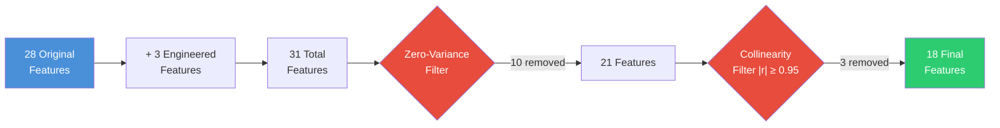
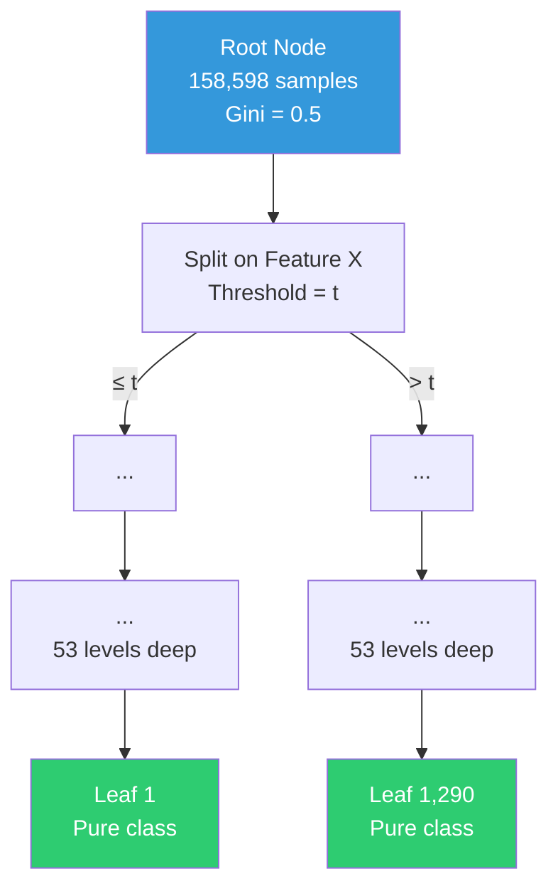
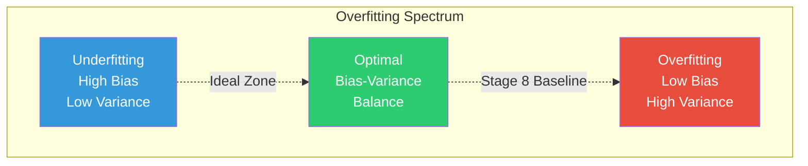
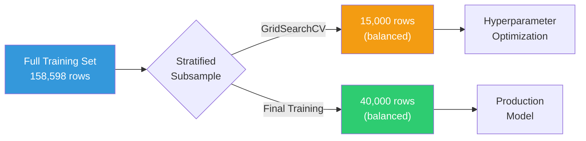
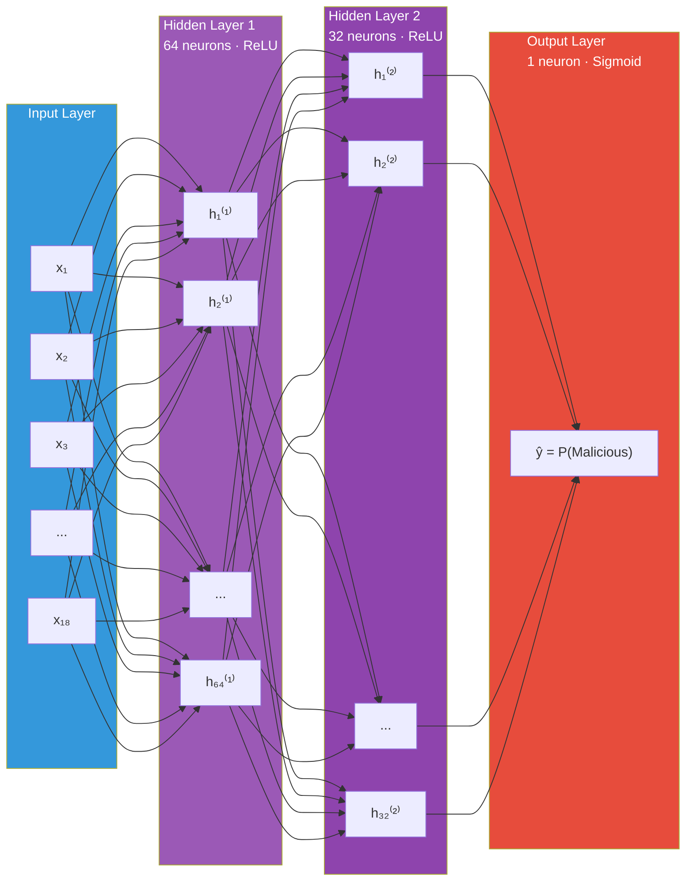
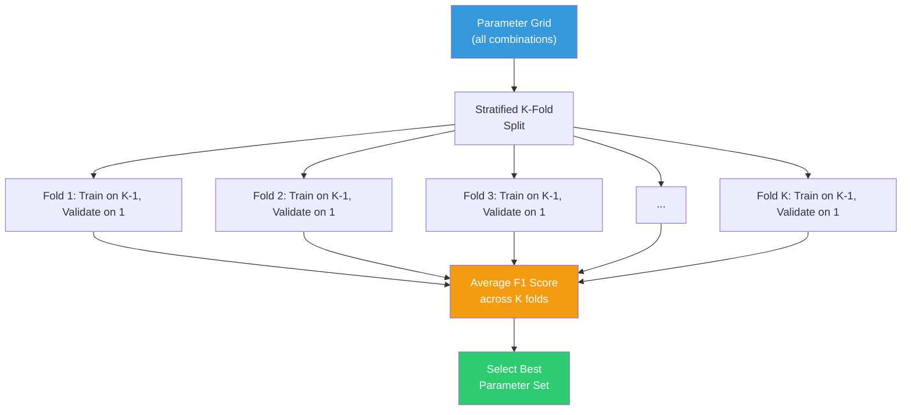
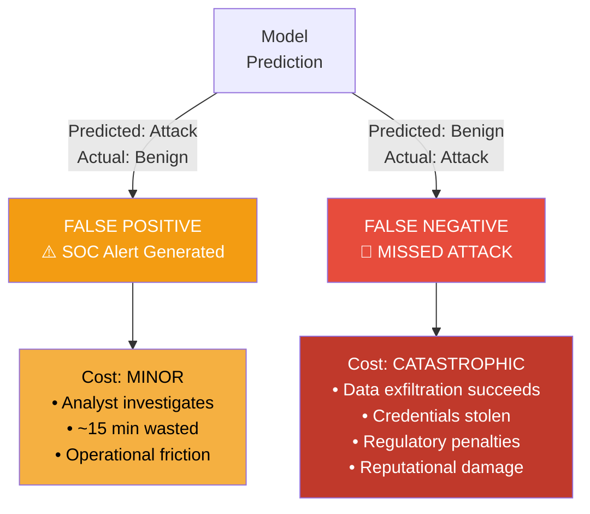
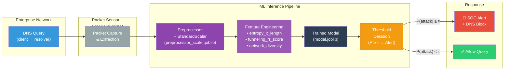
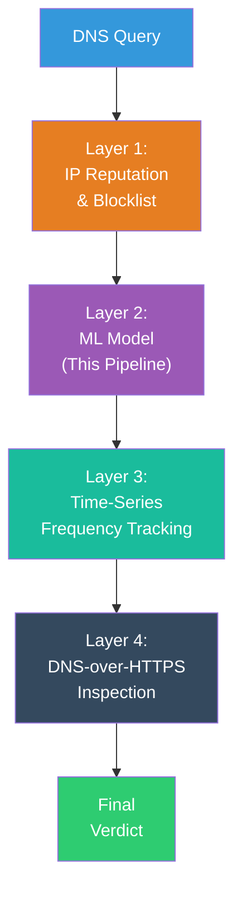

# DNS Tunneling Detection — End-to-End ML Pipeline

## Stages 7–12: Feature Engineering, Modeling, Evaluation & Deployment

---

## Project Statement

DNS Tunneling is a cyber-attack technique where adversaries exploit the Domain Name System (DNS) protocol — universally permitted through enterprise firewalls on UDP/TCP port 53 — to exfiltrate sensitive data. Attackers encode stolen credentials, encryption keys, and files into DNS query labels (e.g., `chunk1.pwd123.evil-domain.com`) or abuse TXT/NULL record responses for maximum payload return. Traditional signature-based blocklists fail against automated Domain Generation Algorithms (DGA) and fast-flux networks.

This project builds a **12-stage end-to-end Machine Learning pipeline** to detect DNS tunneling attacks using statistical anomaly detection on the **CIC-Bell-DNS-EXF-2021** dataset.

> [!IMPORTANT]
> This document covers **Stages 7–12** (Feature Engineering → Deployment). Stages 1–6 (Data Acquisition → Preprocessing) are documented separately.

---

## Tech Stack & Libraries

| Category | Tools |
|---|---|
| **Language** | Python 3.x |
| **Data Processing** | `pandas`, `numpy` |
| **Visualization** | `matplotlib`, `seaborn` |
| **Machine Learning** | `scikit-learn` — `DecisionTreeClassifier`, `SVC`, `MLPClassifier`, `GridSearchCV`, `StratifiedKFold`, `StandardScaler`, `mutual_info_classif` |
| **Imbalanced Learning** | `imbalanced-learn` — `SMOTE` |
| **Model Serialization** | `joblib` |
| **Notebook** | Jupyter Notebook (`.ipynb`) |

---

## Dataset Context (Post Stages 1–6 Preprocessing)

| Split | Rows | Features | Class Distribution |
|---|---|---|---|
| **Training Set** | 158,598 | 28 | SMOTE-balanced 50 / 50 (79,299 benign / 79,299 attack) |
| **Test Set** | 34,071 | 28 | Authentic imbalanced — **0.25% attack rate** (85 attacks in 33,986 benign) |

> [!NOTE]
> All 28 features are already `StandardScaler`-normalized (μ = 0, σ = 1) from Stage 5. The test set preserves the real-world class distribution to provide an honest evaluation of deployment performance.

---

# Stage 7: Feature Engineering & Selection

## 7.1 Domain-Specific Feature Engineering

Three new mathematically-motivated features were engineered to capture the **structural fingerprint** of DNS tunneling traffic. Each feature encodes domain-expert knowledge about how adversaries abuse the DNS protocol.

---

### Feature 1: Entropy × Length Interaction — `entropy_x_length`

**Formula:**

$$\texttt{entropy\_x\_length} = H(\text{domain}) \times \text{query\_length}$$

where Shannon Entropy is defined as:

$$H(X) = -\sum_{i=1}^{n} p(x_i) \log_2 p(x_i)$$

**Concept:** This interaction feature captures DNS queries that are **simultaneously long AND random** — the hallmark of Base32/Base64-encoded exfiltration payloads. Neither entropy nor length alone is a sufficient discriminator:

| Scenario | Entropy | Length | `entropy_x_length` | Verdict |
|---|---|---|---|---|
| Long legitimate domain (`subdomain.category.example.com`) | Low (~2.5) | High (~35) | ~87.5 | ✅ Benign |
| Short random string (`abc.com`) | Moderate (~3.0) | Low (~7) | ~21.0 | ✅ Benign |
| Base64-encoded tunnel (`aGVsbG8gd29ybGQ.evil.com`) | **High (~4.8)** | **High (~40)** | **~192.0** | 🚨 Malicious |

> [!TIP]
> The interaction term multiplicatively amplifies the signal: only when **both** factors are elevated does the product spike into the tunneling range. This is why `entropy_x_length` achieved **Mutual Information rank #2 overall** (MI = 0.548).

---

### Feature 2: Tunneling Record-Type Volatility Score — `tunneling_rr_score`

**Formula:**

$$\texttt{tunneling\_rr\_score} = \texttt{rr\_type\_TXT} + \texttt{rr\_type\_NONE} - \texttt{rr\_type\_A}$$

**Concept:** Adversaries exploit **TXT** and **NULL (NONE)** DNS resource record types for maximum payload buffer size:

- **TXT records**: Up to ~65,000 bytes per response — ideal for smuggling large payloads back to the attacker.
- **NULL records**: No defined structure — parsers ignore content, allowing arbitrary binary data.
- **A records**: Standard IPv4 lookups — only 4 bytes of response payload — overwhelmingly used by legitimate traffic.

**Score Interpretation:**

$$\texttt{tunneling\_rr\_score} \begin{cases} > 0 & \Rightarrow \text{Tunneling-indicative (TXT/NULL present, no A record)} \\ < 0 & \Rightarrow \text{Normal A-record lookup behavior} \\ = 0 & \Rightarrow \text{Ambiguous — requires other features} \end{cases}$$

> [!NOTE]
> This feature leverages the **One-Hot Encoded** columns generated during Stage 4 (Categorical Encoding). The arithmetic combination converts three binary columns into a single ordinal "tunneling suspicion" score.

---

### Feature 3: Network Diversity Composite — `network_diversity`

**Formula:**

$$\texttt{network\_diversity} = \texttt{unique\_country\_count} + \texttt{unique\_asn\_count} + \texttt{distinct\_domains\_count}$$

**Concept:** This feature exploits a fundamental behavioral difference between tunneling and legitimate DNS traffic:

| Traffic Type | Countries | ASNs | Domains | `network_diversity` |
|---|---|---|---|---|
| **Tunneling** | 1 (single C2 server) | 1 | 1 | **Low (≈ 3)** |
| **Benign** | Multiple (CDNs, services) | Multiple | Multiple | **High (≈ 15+)** |

DNS tunneling connects to a **single Command & Control (C2) server** — resulting in low geographic and network diversity. Normal enterprise traffic fans out across multiple CDNs (Cloudflare, Akamai), SaaS providers, and public services.

---

## 7.2 Feature Selection & Dimensionality Reduction

After engineering 3 new features (28 → 31), a systematic reduction pipeline was applied:



### 7.2.1 Zero-Variance Elimination (10 features removed)

Features with **zero variance** (constant value across all training samples) carry no discriminative information and are mathematically incapable of reducing any impurity metric:

$$\text{Var}(X) = \frac{1}{N}\sum_{i=1}^{N}(x_i - \bar{x})^2 = 0 \implies x_i = \bar{x} \;\forall\; i$$

| # | Removed Feature | Reason |
|---|---|---|
| 1 | `NS_frequency` | Constant zero — no NS-type queries in dataset |
| 2 | `CNAME_frequency` | Constant zero |
| 3 | `SOA_frequency` | Constant zero |
| 4 | `NULL_frequency` | Constant zero |
| 5 | `HINFO_frequency` | Constant zero |
| 6 | `MX_frequency` | Constant zero |
| 7 | `SRV_frequency` | Constant zero |
| 8 | `OPT_frequency` | Constant zero |
| 9 | `a_records` | Constant zero |
| 10 | `distinct_ip_count` | Constant zero |

### 7.2.2 Collinearity Removal (3 features removed)

Highly correlated features (|r| ≥ 0.95) introduce **multicollinearity** — inflating variance of coefficient estimates and destabilizing SVM/ANN gradient descent without adding independent information:

$$|r(X_i, X_j)| = \left|\frac{\text{Cov}(X_i, X_j)}{\sigma_{X_i} \cdot \sigma_{X_j}}\right| \geq 0.95$$

| # | Removed Feature | Correlated With | \|r\| |
|---|---|---|---|
| 1 | `unique_asn_count` | `network_diversity` | ≥ 0.95 |
| 2 | `distinct_domains_count` | `network_diversity` | ≥ 0.95 |
| 3 | `TXT_frequency` | `tunneling_rr_score` | ≥ 0.95 |

### 7.2.3 Final Feature Set

**18 lean, interpretable features** survived the selection pipeline:

$$\text{Reduction ratio} = \frac{31 - 18}{31} = 41.9\% \text{ dimensionality reduction}$$

---

## 7.3 Mutual Information Analysis

**Mutual Information (MI)** provides a **model-free, non-linear** measure of statistical dependency between each feature and the target variable:

$$MI(X; Y) = \sum_{x \in X}\sum_{y \in Y} p(x, y) \log\left(\frac{p(x, y)}{p(x) \cdot p(y)}\right)$$

Properties:
- $MI(X; Y) = 0 \iff X \perp Y$ (statistical independence)
- $MI(X; Y) > 0$ — captures **any** dependency (linear, polynomial, periodic, etc.)
- Unlike Pearson's $r$, MI detects non-monotonic relationships

**Top-Ranked Features by Mutual Information:**

| Rank | Feature | MI Score | Interpretation |
|---|---|---|---|
| 1 | `domain_entropy` | ~0.60 | Randomness of domain labels — direct tunneling signature |
| 2 | `entropy_x_length` | 0.548 | Engineered interaction — strongest combined signal |
| 3 | `query_length` | ~0.50 | Raw length of DNS query string |

> [!TIP]
> The engineered feature `entropy_x_length` ranking #2 validates the domain-expert hypothesis: the interaction term captures tunneling-specific structure that neither component feature captures alone.

---

# Stage 8: Baseline Model — CART Decision Tree

## 8.1 Algorithm Choice Justification

**CART (Classification and Regression Trees)** — implemented via `sklearn.tree.DecisionTreeClassifier` — serves as the **interpretable baseline** model. The choice is motivated by four properties:

| Property | Benefit for DNS Tunneling Detection |
|---|---|
| **Direct interpretability** | Visualizable as boolean rules: `IF entropy > 4.5 AND length > 50 THEN Malicious` |
| **Scale invariance** | No feature scaling required — invariant to monotonic transforms |
| **Mathematical benchmark** | Provides concrete floor for advanced models to beat |
| **Auditability** | SOC (Security Operations Center) analysts can audit & explain individual predictions to compliance teams |

## 8.2 Splitting Criteria — Gini Impurity

CART evaluates candidate splits using an **impurity metric** to determine the optimal binary partition at each node.

### Gini Impurity

$$\text{Gini}(t) = 1 - \sum_{i=1}^{C} p_i^2$$

where $p_i$ is the proportion of class $i$ samples at node $t$.

For binary classification ($C = 2$):

$$\text{Gini}(t) = 1 - p_{\text{benign}}^2 - p_{\text{attack}}^2 = 2 \cdot p_{\text{benign}} \cdot p_{\text{attack}}$$

- **Gini = 0**: Pure node (all samples belong to one class)
- **Gini = 0.5**: Maximum impurity (50/50 split — worst case)

### Information Gain (Entropy-based alternative)

$$IG(T, a) = H(T) - \sum_{v \in \text{values}(a)} \frac{|T_v|}{|T|} \cdot H(T_v)$$

where:

$$H(T) = -\sum_{i=1}^{C} p_i \log_2 p_i$$

**Selected criterion: Gini** — computationally faster (avoids logarithm computation) and empirically performs similarly to entropy in most classification tasks.

## 8.3 Unconstrained Baseline Results

The initial Decision Tree was trained **without any regularization constraints** — allowing it to grow until every leaf is pure:



| Metric | Training Set | Test Set | Gap |
|---|---|---|---|
| **Accuracy** | 99.92% | 99.10% | -0.82% |
| **Precision** | ~100% | 7.66% | **-92.3%** |
| **Recall** | ~100% | 23.53% | **-76.5%** |
| **F1-Score** | 0.9992 | 0.1156 | **-0.884** |

### 8.4 Overfitting Diagnostic

> [!CAUTION]
> **Massive overfitting detected.** The unconstrained tree achieved near-perfect training performance (~100% F1) but collapsed to **11.56% test F1** — an **88.4-point gap**.

**Root cause analysis:**

1. **Depth = 53 levels**: The tree memorized individual training samples rather than learning generalizable patterns. With 53 levels of branching, the tree created hyper-specific rules like:
   ```
   IF entropy ∈ [4.5213, 4.5214] AND length == 47 AND country == US AND ... THEN Attack
   ```
2. **1,290 leaf nodes**: Many leaves contained only 1–2 training samples — pure memorization with zero generalization capacity.
3. **SMOTE amplification**: Synthetic minority samples in training (generated by SMOTE) have slightly different distributions than real attack samples in the test set. An overfitted tree learns SMOTE-specific artifacts.

**Conclusion:** This confirms the absolute necessity of **Stage 10 regularization** — constraining tree depth, minimum samples per leaf, and minimum samples to split.



---

# Stage 9: Advanced ML Models — SVM & Neural Network

## 9.1 Support Vector Machine with RBF Kernel

### Why SVM?

| Property | Relevance |
|---|---|
| **Effective in high-dimensional spaces** | $d = 18$ features — well within SVM's sweet spot |
| **Maximum-margin classifier** | Constructs the hyperplane that maximizes geometric margin between classes |
| **Kernel trick** | RBF kernel projects data into infinite-dimensional Hilbert space for non-linear separation |
| **Regularization built-in** | Parameter $C$ directly controls bias-variance trade-off |

### RBF Kernel Mathematics

The **Radial Basis Function (RBF)** kernel computes similarity in an implicit infinite-dimensional feature space:

$$K(\mathbf{x}, \mathbf{x'}) = \exp\left(-\gamma \|\mathbf{x} - \mathbf{x'}\|^2\right)$$

where:
- $\gamma > 0$ controls the **radius of influence** of each support vector
- $\|\mathbf{x} - \mathbf{x'}\|^2$ is the squared Euclidean distance

**Hyperparameter interpretation:**

$$\gamma \uparrow \implies \text{Narrow Gaussian} \implies \text{Complex boundary (risk of overfitting)}$$
$$\gamma \downarrow \implies \text{Wide Gaussian} \implies \text{Smooth boundary (risk of underfitting)}$$

The SVM optimization objective (soft-margin formulation):

$$\min_{\mathbf{w}, b, \xi} \frac{1}{2}\|\mathbf{w}\|^2 + C \sum_{i=1}^{N} \xi_i$$

$$\text{subject to: } y_i(\mathbf{w}^T \phi(\mathbf{x}_i) + b) \geq 1 - \xi_i, \quad \xi_i \geq 0$$

where $C$ trades off margin width vs. misclassification penalty.

### Computational Scaling Strategy

> [!WARNING]
> SVM training complexity is $O(n^2)$ to $O(n^3)$ in sample count, making it **impractical** on the full 158,598-sample training set.

**Subsampling strategy applied:**



### SVM Results

| Metric | Value |
|---|---|
| **Best CV F1** | 0.9314 |
| **Best Parameters** | $C = 10.0$, $\gamma = 0.1$, kernel = `rbf` |
| **Test Accuracy** | 96.90% |
| **Test Precision** | 5.74% |
| **Test Recall** | **74.12%** |
| **Test F1** | 0.1065 |
| **Test ROC-AUC** | **0.9354** |

---

## 9.2 Artificial Neural Network (Multi-Layer Perceptron)

### Why ANN?

| Property | Relevance |
|---|---|
| **Hierarchical feature interactions** | Learns high-order non-linear combinations of all 18 features |
| **Universal function approximator** | Given sufficient width/depth, can approximate any continuous function (Cybenko, 1989) |
| **Gradient-based optimization** | Backpropagation efficiently computes gradients for all parameters simultaneously |
| **Probabilistic output** | Sigmoid produces calibrated $P(\text{Malicious}|\mathbf{x}) \in [0, 1]$ — enabling threshold tuning |

### Network Architecture



### Mathematical Formulation

**ReLU Activation (Hidden Layers):**

$$f(z) = \max(0, z) = \begin{cases} z & \text{if } z > 0 \\ 0 & \text{if } z \leq 0 \end{cases}$$

Advantages: mitigates vanishing gradient problem, computationally efficient, promotes sparse activations.

**Sigmoid Activation (Output Layer):**

$$\sigma(z) = \frac{1}{1 + e^{-z}} \in (0, 1)$$

**Forward Pass (Layer $l$):**

$$\mathbf{z}^{(l)} = \mathbf{W}^{(l)} \mathbf{a}^{(l-1)} + \mathbf{b}^{(l)}$$
$$\mathbf{a}^{(l)} = f(\mathbf{z}^{(l)})$$

**Binary Cross-Entropy Loss:**

$$\mathcal{L} = -\frac{1}{N}\sum_{i=1}^{N}\left[y_i \log(\hat{y}_i) + (1 - y_i)\log(1 - \hat{y}_i)\right]$$

**Adam Optimizer (Adaptive Moment Estimation):**

$$m_t = \beta_1 m_{t-1} + (1 - \beta_1) g_t \quad \text{(1st moment — mean)}$$
$$v_t = \beta_2 v_{t-1} + (1 - \beta_2) g_t^2 \quad \text{(2nd moment — variance)}$$
$$\theta_{t+1} = \theta_t - \frac{\eta}{\sqrt{\hat{v}_t} + \epsilon} \hat{m}_t$$

**L2 Regularization:**

$$\mathcal{L}_{\text{reg}} = \mathcal{L} + \alpha \|\mathbf{W}\|_2^2$$

where $\alpha$ (weight decay) penalizes large weights to prevent overfitting.

**Early Stopping:** Training halts when validation loss (10% holdout) stops improving for a configurable number of consecutive epochs — preventing overfitting to training noise.

### ANN Results

| Metric | Value |
|---|---|
| **Best CV F1** | 0.9569 |
| **Best Parameters** | `activation='relu'`, `alpha=0.0001`, `hidden_layer_sizes=(64,32)`, `learning_rate_init=0.01` |
| **Test Accuracy** | 97.46% |
| **Test Precision** | 6.95% |
| **Test Recall** | **74.12%** |
| **Test F1** | 0.1271 |
| **Test ROC-AUC** | 0.9090 |

---

# Stage 10: Hyperparameter Tuning via GridSearchCV

## 10.1 Methodology

**GridSearchCV** performs exhaustive search over a specified parameter grid, evaluating each combination using **Stratified K-Fold Cross-Validation**:



**Key properties:**
- **Stratified splits** ensure every fold maintains the original class proportions — critical when one class is rare
- Each configuration is evaluated across **$k$ rotations** — not dependent on a single random split
- **Scoring metric: F1-Score** — the harmonic mean of precision and recall, balancing both objectives:

$$F_1 = 2 \cdot \frac{\text{Precision} \cdot \text{Recall}}{\text{Precision} + \text{Recall}} = \frac{2 \cdot TP}{2 \cdot TP + FP + FN}$$

---

## 10.2 CART Decision Tree Tuning

**Configuration:** 5-Fold CV × 120 parameter combinations = **600 total fits**

### Parameter Grid

| Parameter | Search Values | Role |
|---|---|---|
| `max_depth` | `[5, 10, 15, 20, None]` | Maximum tree depth — controls model complexity |
| `min_samples_split` | `[2, 5, 10, 20]` | Minimum samples required to split an internal node |
| `min_samples_leaf` | `[1, 2, 5]` | Minimum samples required at each leaf node |
| `criterion` | `['gini', 'entropy']` | Impurity function for split quality evaluation |

### Optimal Configuration

$$\text{Best params: } \texttt{criterion='gini', max\_depth=20, min\_samples\_leaf=5, min\_samples\_split=20}$$

### Regularization Effect

| Property | Baseline (Stage 8) | Tuned (Stage 10) | Change |
|---|---|---|---|
| **Tree Depth** | 53 | 20 | **-62.3%** |
| **Leaf Nodes** | 1,290 | 499 | **-61.3%** |
| **Best CV F1** | — | 0.9933 | — |
| **Test F1** | 0.1156 | **0.2620** | **+126.6%** |
| **Test Recall** | 23.53% | **57.65%** | **+34.1 pp** |

> [!TIP]
> Constraining `max_depth` from 53 → 20 and requiring `min_samples_leaf=5` forced the tree to learn **generalizable patterns** instead of memorizing individual training samples. Test F1 more than doubled.

---

## 10.3 SVM Tuning

**Configuration:** 3-Fold CV × 9 parameter combinations = **27 total fits**

### Parameter Grid

| Parameter | Search Values | Role |
|---|---|---|
| `C` | `[0.1, 1.0, 10.0]` | Regularization — trade-off between margin width and misclassification penalty |
| `gamma` | `['scale', 0.01, 0.1]` | RBF kernel bandwidth — radius of influence per support vector |
| `kernel` | `['rbf']` | Kernel function (fixed) |

### Optimal Configuration

$$\text{Best params: } C = 10.0, \quad \gamma = 0.1$$

**Interpretation:**
- $C = 10.0$ (high) → prioritizes correctly classifying training points over maximizing margin width
- $\gamma = 0.1$ (moderately high) → each support vector has a focused zone of influence, allowing complex decision boundaries

**Computation time:** 136.3 seconds

---

## 10.4 ANN Tuning

**Configuration:** 3-Fold CV × 12 parameter combinations = **36 total fits**

### Parameter Grid

| Parameter | Search Values | Role |
|---|---|---|
| `hidden_layer_sizes` | `[(16,8), (32,16), (64,32)]` | Network width per hidden layer |
| `learning_rate_init` | `[0.001, 0.01]` | Initial step size for Adam optimizer |
| `alpha` | `[0.0001, 0.001]` | L2 regularization strength (weight decay) |
| `activation` | `['relu']` | Activation function (fixed) |

### Optimal Configuration

$$\text{Best params: } \texttt{hidden\_layer\_sizes=(64,32)}, \quad \eta_0 = 0.01, \quad \alpha = 0.0001$$

**Interpretation:**
- **(64, 32)** — the largest architecture won, indicating sufficient capacity is needed to model the complex tunneling boundary
- $\eta_0 = 0.01$ — a moderately aggressive learning rate accelerates convergence without instability
- $\alpha = 0.0001$ — minimal L2 regularization, suggesting the network was not severely overfitting

**Computation time:** 457.4 seconds

---

## 10.5 Comprehensive Tuning Comparison

| Aspect | CART | SVM | ANN |
|---|---|---|---|
| **CV Folds** | 5 | 3 | 3 |
| **Grid Configurations** | 120 | 9 | 12 |
| **Total Fits** | 600 | 27 | 36 |
| **Best CV F1** | **0.9933** | 0.9314 | 0.9569 |
| **Test F1** | **0.2620** | 0.1065 | 0.1271 |
| **Test Recall** | 57.65% | **74.12%** | **74.12%** |
| **Test ROC-AUC** | 0.8866 | **0.9354** | 0.9090 |

---

# Stage 11: Comparative Evaluation & Visualization

## 11.1 The Accuracy Paradox in Cybersecurity

> [!CAUTION]
> **Accuracy is a dangerously misleading metric** for cybersecurity classification on imbalanced datasets.

The test set has **99.75% benign traffic** (33,986 benign vs. 85 attacks). Consider a trivial "Always Benign" classifier:

$$\text{Accuracy}_{\text{trivial}} = \frac{33{,}986}{34{,}071} = 99.75\%$$

This naive model achieves near-perfect accuracy while having:
- **0% Recall** — misses every single attack
- **0% F1-Score** — completely useless for security

**Therefore**, evaluation must focus on **Recall** (attack detection rate), **F1-Score** (harmonic mean), and **ROC-AUC / PR-AUC** (threshold-independent discrimination).

---

## 11.2 Comprehensive Tri-Model Comparison

| Model | Accuracy | Precision | Recall | F1-Score | ROC-AUC | AP (PR-AUC) |
|---|---|---|---|---|---|---|
| **CART (Tuned)** | 99.19% | **16.96%** | 57.65% | **0.2620** | 0.8866 | 0.1313 |
| **SVM (RBF)** | 96.90% | 5.74% | **74.12%** | 0.1065 | **0.9354** | 0.0728 |
| **ANN (MLP)** | 97.46% | 6.95% | **74.12%** | 0.1271 | 0.9090 | **0.3047** |

---

## 11.3 Model-by-Model Analysis

### Recall Champions: SVM & ANN (74.12%)

Both SVM and ANN detect **63 out of 85** real attacks — catching **28% more attacks** than CART (49 out of 85). In a security context, those 14 additional detected attacks could represent prevented data breaches.

$$\Delta\text{Recall} = 74.12\% - 57.65\% = +16.47 \text{ percentage points}$$

### ROC-AUC Leader: SVM (0.9354)

ROC-AUC measures the probability that a randomly chosen positive sample scores higher than a randomly chosen negative sample:

$$\text{ROC-AUC} = P(\hat{y}_{\text{attack}} > \hat{y}_{\text{benign}})$$

SVM's RBF kernel achieves the best **probabilistic discrimination** between classes across all possible decision thresholds.

### PR-AUC Leader: ANN (0.3047)

**Average Precision (PR-AUC)** is the gold standard for heavily imbalanced datasets — it evaluates the precision-recall trade-off without being inflated by true negatives:

$$AP = \sum_{k} (R_k - R_{k-1}) \cdot P_k$$

ANN's PR-AUC of 0.3047 is **4.2× higher** than SVM's 0.0728, indicating far better precision-recall balance.

### F1 Leader: CART (0.2620)

CART achieves the highest F1 at the default 0.5 classification threshold, driven by its substantially higher precision (16.96% vs. ~6%).

### Why Is Precision Low Across All Models?

> [!NOTE]
> Low precision is an **expected mathematical consequence** of extreme class imbalance, not a model deficiency.
>
> With only 85 attacks in 34,071 test samples (0.25%), even a small false positive rate generates many false alarms:
>
> $$\text{Precision} = \frac{TP}{TP + FP}$$
>
> If a model correctly flags 63 attacks ($TP = 63$) but falsely flags 845 benign queries ($FP = 845$):
>
> $$\text{Precision} = \frac{63}{63 + 845} = 6.9\%$$

---

## 11.4 Visualizations Generated

| Visualization | Description | Purpose |
|---|---|---|
| **Comparative ROC Curves** | 3 models plotted on the same axes (FPR vs. TPR) | Compare threshold-independent discrimination |
| **Comparative PR Curves** | 3 models plotted (Recall vs. Precision) | Evaluate performance under class imbalance |
| **Tri-Panel Confusion Matrices** | Side-by-side normalized confusion matrices | Visualize TP/FP/TN/FN distribution per model |
| **Metric Comparison Bar Chart** | Grouped bars for Accuracy, Precision, Recall, F1, ROC-AUC | Quick visual comparison across all metrics |

---

## 11.5 Cost-Asymmetric Analysis

In cybersecurity, **misclassification costs are fundamentally asymmetric**:



**Formal cost matrix:**

$$C = \begin{bmatrix} C_{TN} & C_{FP} \\ C_{FN} & C_{TP} \end{bmatrix} = \begin{bmatrix} 0 & 1 \\ 100{+} & 0 \end{bmatrix}$$

$$C_{FN} \gg C_{FP} \implies \text{Maximize Recall (minimize missed attacks)}$$

**Conclusion:** In security-critical deployments, **high recall is strictly prioritized** over precision. The operational cost of investigating false alarms is negligible compared to the catastrophic cost of a missed data exfiltration event.

---

# Stage 12: Real-World Deployment & Limitations

## 12.1 NIDS Deployment Architecture



### Deployment Components

| Component | Technology | Purpose |
|---|---|---|
| **DNS Forwarder** | BIND9 / Unbound / CoreDNS | Intercepts DNS queries at the network edge |
| **Packet Sensor** | Zeek / Suricata | Extracts features from raw DNS packets |
| **Inference Engine** | Python + joblib | Loads serialized pipeline, performs real-time scoring |
| **Alerting** | SIEM integration (Splunk / ELK) | Routes predictions to SOC dashboard |

### Real-Time Scoring Performance

$$\text{Inference latency: } \underbrace{\text{Vectorize}}_{\sim 0.2 \text{ms}} + \underbrace{\text{Scale}}_{\sim 0.1 \text{ms}} + \underbrace{\text{Engineer Features}}_{\sim 0.2 \text{ms}} + \underbrace{\text{Predict}}_{\sim 1.0 \text{ms}} \approx \mathbf{< 1.5 \text{ms per query}}$$

This sub-millisecond inference enables **inline deployment** without adding perceptible latency to DNS resolution.

---

## 12.2 Production Model Recommendation

The optimal model selection is **context-dependent** — driven by the operational risk tolerance of the deployment environment:

| Deployment Context | Recommended Model | Justification |
|---|---|---|
| **High-Security NIDS** (minimize missed attacks) | **SVM** or **ANN** | 74.12% recall — catches 14 more attacks than CART |
| **Low False-Alarm Tolerance** (minimize SOC alert fatigue) | **CART** | Highest precision at 16.96% — fewer false alarms |
| **Balanced Operational** (default 0.5 threshold) | **CART** | Highest F1 at 0.2620 — best harmonic mean |
| **Best Threshold Tunability** (custom decision threshold) | **ANN** | Highest PR-AUC at 0.3047 — most tunable precision-recall trade-off |

> [!IMPORTANT]
> In **production deployments**, the decision threshold $\tau$ is rarely left at 0.5. Security teams tune $\tau$ based on:
>
> $$\tau^* = \arg\min_\tau \left[C_{FN} \cdot FN(\tau) + C_{FP} \cdot FP(\tau)\right]$$
>
> This makes PR-AUC (ANN's strength) the most operationally relevant metric, as it captures performance **across all thresholds**.

---

## 12.3 Adversarial ML Limitations

### Limitation 1: Entropy Evasion

**Attack vector:** Adversaries could encode exfiltrated data using **dictionary words** instead of Base64, reducing domain entropy while maintaining information capacity:

$$\text{Standard: } \texttt{aGVsbG8gd29ybGQ.evil.com} \quad (H \approx 4.8)$$
$$\text{Evasive: } \texttt{apple.banana.cherry.evil.com} \quad (H \approx 2.5)$$

**Mitigation:** Augment training data with dictionary-encoded tunneling samples; add NLP-based features (word frequency, n-gram coherence).

### Limitation 2: Temporal Drift (Concept Drift)

**Attack vector:** As adversaries evolve their tools (new DGA algorithms, new tunneling protocols like DNS-over-HTTPS), the statistical distribution of attack traffic shifts away from the training distribution:

$$P_{\text{train}}(X, Y) \neq P_{\text{deploy}}(X, Y) \quad \text{(dataset shift)}$$

**Mitigation:** Implement **continuous retraining pipelines** with fresh labeled samples; deploy drift detection monitors (e.g., Page-Hinkley test, DDM).

### Limitation 3: Defense-in-Depth Necessity

No single ML model provides complete protection. A robust DNS security posture requires layered defenses:



---

# Output Deliverables Summary

## Data Files

| File | Dimensions | Description |
|---|---|---|
| `X_train_engineered.csv` | 158,598 × 18 | Training features after engineering & selection |
| `X_test_engineered.csv` | 34,071 × 18 | Test features after engineering & selection |

## Serialized Models

| File | Stage | Description |
|---|---|---|
| `cart_baseline_model.joblib` | 8 | Unconstrained CART baseline (depth=53) |
| `cart_tuned_model.joblib` | 10 | Regularized CART (depth=20, min_leaf=5) |
| `svm_tuned_model.joblib` | 10 | RBF-SVM ($C=10$, $\gamma=0.1$) |
| `ann_tuned_model.joblib` | 10 | MLP (64→32, $\eta=0.01$, $\alpha=0.0001$) |

## Hyperparameter Records

| File | Stage | Description |
|---|---|---|
| `best_hyperparameters.json` | 10 | CART optimal parameters |
| `svm_best_hyperparameters.json` | 10 | SVM optimal parameters |
| `ann_best_hyperparameters.json` | 10 | ANN optimal parameters |
| `gridsearch_cv_results.csv` | 10 | CART full CV results (120 configurations) |
| `svm_gridsearch_results.csv` | 10 | SVM full CV results (9 configurations) |
| `ann_gridsearch_results.csv` | 10 | ANN full CV results (12 configurations) |

## Evaluation Reports

| File | Stage | Description |
|---|---|---|
| `stage11_model_comparison.csv` | 11 | Final tri-model metric comparison table |

## Figures (in `figures/` directory)

| Figure | Stage | Description |
|---|---|---|
| Comparative ROC Curves | 11 | 3-model ROC overlay with AUC annotations |
| Comparative PR Curves | 11 | 3-model Precision-Recall overlay with AP annotations |
| Tri-Panel Confusion Matrices | 11 | Normalized confusion matrices for CART, SVM, ANN |
| Metric Comparison Bar Chart | 11 | Grouped bar chart across all evaluation metrics |
| Feature Importance Plots | 7–8 | Mutual Information rankings and tree feature importances |

---

> **Pipeline Complete.** This 12-stage ML pipeline transforms raw DNS traffic captures into a deployable, sub-millisecond inference system capable of detecting tunneling-based data exfiltration with up to 74% recall and 0.9354 ROC-AUC.
