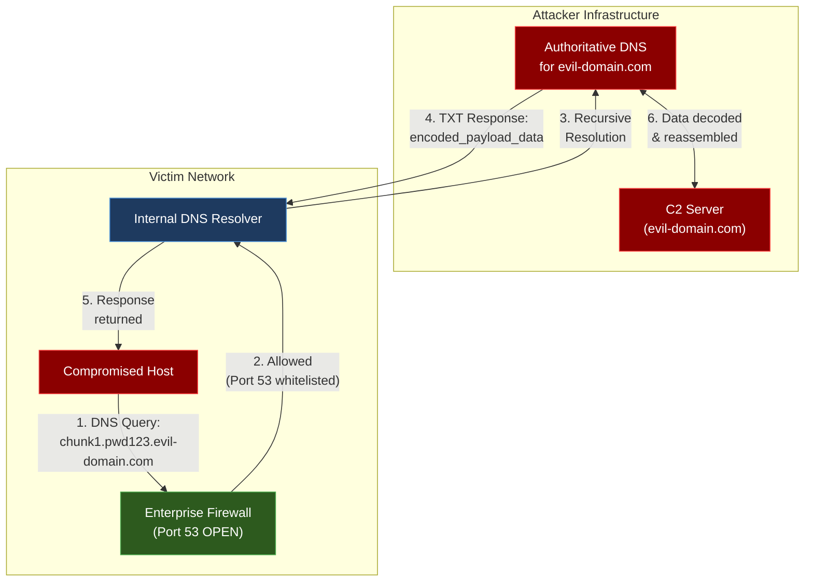
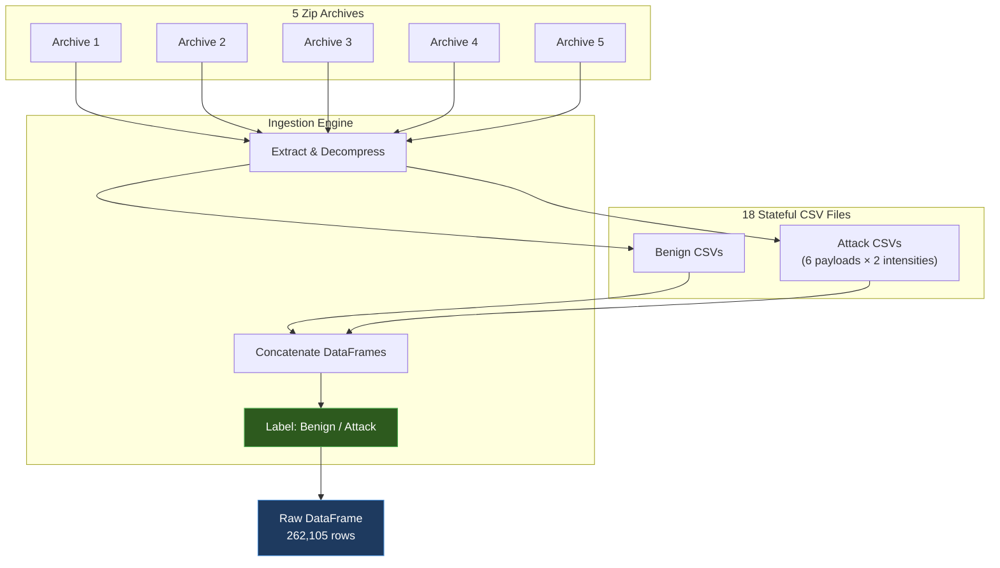
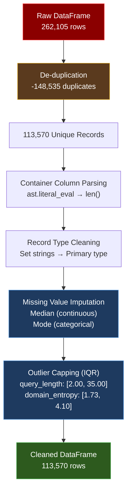
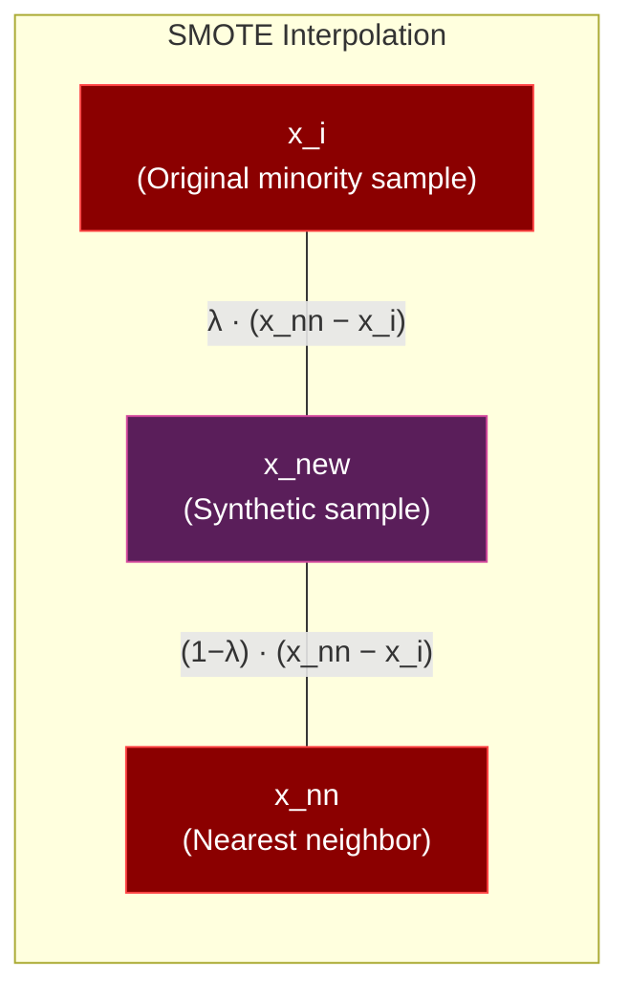
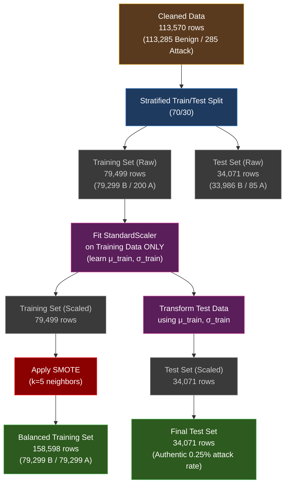
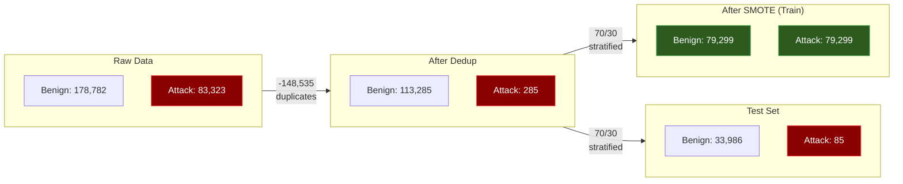
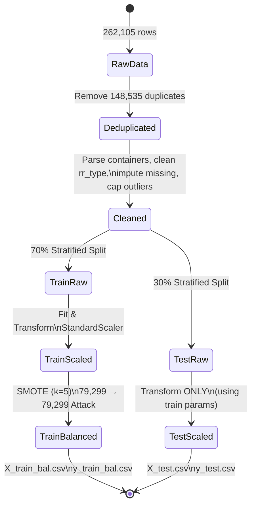

# DNS Tunneling Detection — End-to-End Machine Learning Pipeline

## Stages 1–6: Data Preprocessing Pipeline

---

## Table of Contents

1. [Project Statement](#1-project-statement)
2. [Tech Stack & Libraries](#2-tech-stack--libraries)
3. [Dataset Overview](#3-dataset-overview)
4. [Stage 1 & 2 — Problem Definition & Data Acquisition](#stage-1--2--problem-definition--data-acquisition)
5. [Stage 3 — Data Cleaning, Imputation & Outlier Treatment](#stage-3--data-cleaning-imputation--outlier-treatment)
6. [Stage 4 — Categorical Encoding & Feature Scaling](#stage-4--categorical-encoding--feature-scaling)
7. [Stage 5 — Train/Test Split & SMOTE Balancing](#stage-5--traintest-split--smote-balancing)
8. [Stage 6 — Exploratory Data Analysis (EDA)](#stage-6--exploratory-data-analysis-eda)
9. [Output Data Summary](#output-data-summary)

---

## 1. Project Statement

DNS Tunneling is a cyber-attack technique where adversaries exploit the **Domain Name System (DNS)** protocol — universally permitted through enterprise firewalls on **UDP/TCP port 53** — to exfiltrate sensitive data. Attackers encode stolen credentials, encryption keys, and files into DNS query labels (e.g., `chunk1.pwd123.evil-domain.com`) or abuse `TXT`/`NULL` record responses for maximum payload return. Traditional signature-based blocklists fail against automated **Domain Generation Algorithms (DGA)** and **fast-flux networks**.

This project builds a **12-stage end-to-end Machine Learning pipeline** to detect DNS tunneling attacks using statistical anomaly detection on the **CIC-Bell-DNS-EXF-2021** dataset.

---

## 2. Tech Stack & Libraries

| Category | Tools |
|:---|:---|
| **Language** | Python 3.x |
| **Data Processing** | `pandas`, `numpy` |
| **Visualization** | `matplotlib`, `seaborn` |
| **Machine Learning** | `scikit-learn` — `DecisionTreeClassifier`, `SVC`, `MLPClassifier`, `GridSearchCV`, `StratifiedKFold`, `StandardScaler` |
| **Imbalanced Learning** | `imbalanced-learn` — `SMOTE` |
| **Model Serialization** | `joblib` |
| **Notebook** | Jupyter Notebook (`.ipynb`) |

---

## 3. Dataset Overview

| Property | Value |
|:---|:---|
| **Source** | CIC-Bell-DNS-EXF-2021 (Canadian Institute for Cybersecurity) |
| **Raw Volume** | 262,105 records |
| **Source Files** | 18 stateful CSV files across 5 zip archives |
| **Attack Scenarios** | 12 scenarios (6 payload types × 2 intensities: heavy / light) |

### Feature Categories

| Category | Features |
|:---|:---|
| **Continuous** | `query_length`, `domain_entropy`, `ttl_mean`, `ttl_variance`, `rr_count` |
| **Frequency-based** | `A_frequency`, `TXT_frequency`, etc. |
| **Container Cardinalities** | `distinct_ip_count`, `unique_country_count`, etc. |
| **Categorical** | `rr_type` |

---

## Stage 1 & 2 — Problem Definition & Data Acquisition

### 2.1 DNS Tunneling Threat Model

DNS tunneling exploits the trust implicitly granted to DNS traffic. Because DNS resolution is **essential for virtually all network activity**, port 53 is almost never blocked by firewalls. Attackers weaponize this by:

1. **Encoding data into query labels** — Sensitive payloads (credentials, files) are Base32/Base64-encoded and fragmented into DNS subdomain labels, each constrained to 63 characters per label and 253 characters total per FQDN (RFC 1035).
2. **Using uncommon record types** — `TXT` records (up to ~65 KB) and `NULL` records provide large response payloads, enabling bidirectional communication.
3. **Domain Generation Algorithms (DGA)** — Algorithmically generated domains evade static blocklists by producing thousands of throwaway domain names.
4. **Fast-flux DNS** — Rapidly rotating IP addresses behind DNS records frustrate IP-based blocking.

### 2.2 Data Ingestion Pipeline

The CIC-Bell-DNS-EXF-2021 dataset is distributed across **5 zip archives**, each containing subsets of the 18 stateful CSV files. The ingestion process programmatically extracts, concatenates, and labels all records.

### 2.3 Raw Data Class Distribution

| Class | Count | Percentage |
|:---|---:|---:|
| **Benign** | 178,782 | 68.21% |
| **Attack** | 83,323 | 31.79% |
| **Total** | **262,105** | **100.00%** |

> [!NOTE]
> While the raw data appears reasonably balanced at ~68/32, the post-deduplication distribution reveals a **far more extreme imbalance** (99.75% Benign / 0.25% Attack), because the majority of duplicate records originate from the attack class.

---

## Stage 3 — Data Cleaning, Imputation & Outlier Treatment

### 3.1 De-duplication

**148,535 exact duplicate rows** were identified and removed, reducing the dataset from 262,105 to **113,570 unique records**.

$$
\text{Duplicate Rate} = \frac{148{,}535}{262{,}105} \times 100 = 56.67\%
$$

The high duplication rate is characteristic of DNS traffic data: benign resolvers cache and replay identical queries, while attack tools often retransmit payloads for reliability.

### 3.2 Container Column Parsing

Several columns in the raw dataset store **Python literal strings** rather than numeric values. These represent sets or lists serialized during data collection:

| Column | Raw Format | Parsed Output |
|:---|:---|:---|
| `distinct_ip` | `"{'192.168.1.1', '10.0.0.2'}"` | Cardinality: `2` |
| `unique_country` | `"{'CA', 'US', 'DE'}"` | Cardinality: `3` |
| `unique_asn` | `"set()"` | Cardinality: `0` |
| `distinct_domains` | `"{'google.com'}"` | Cardinality: `1` |
| `unique_ttl` | `"{'300', '3600'}"` | Cardinality: `2` |

**Parsing method**: `ast.literal_eval()` safely evaluates each string into a Python set, then `len()` extracts the cardinality. This avoids `eval()` which would pose a **code injection risk**.

### 3.3 Record Type Cleaning

The `rr_type` column stores DNS record types as Python set strings (e.g., `"{'A'}"`, `"{'TXT', 'A'}"`). Cleaning extracts the **primary record type**:

- Single-element sets → extract the element directly (e.g., `"{'A'}"` → `"A"`)
- Multi-element sets → select the dominant (most informative) type
- Empty sets → mapped to `"NONE"`

### 3.4 Missing Value Imputation

#### Strategy Selection

| Strategy | Applied? | Rationale |
|:---|:---:|:---|
| **Median Imputation** | ✅ Yes (continuous) | Robust to skewness; unaffected by extreme outliers |
| **Mode Imputation** | ✅ Yes (categorical) | Preserves the most frequent category |
| **Mean Imputation** | ❌ No | Network metrics exhibit extreme positive skewness — the mean is distorted by long-tailed distributions |
| **Deletion (listwise)** | ❌ No | Would lose rare attack samples that are critical for minority class learning |

#### Why Not Mean Imputation?

DNS features like `query_length` and `ttl_mean` follow **heavily right-skewed distributions**. In such distributions:

$$
\text{Mean} \gg \text{Median}
$$

For a right-skewed feature with outliers at $x = 10{,}000$:

$$
\bar{x} = \frac{\sum_{i=1}^{n} x_i}{n} \quad \text{(pulled toward extreme values)}
$$

$$
\tilde{x} = x_{\lceil n/2 \rceil} \quad \text{(robust to extremes)}
$$

Mean imputation would artificially inflate missing values, distorting the feature distribution and degrading model performance.

#### Why Not Deletion?

With only **285 attack samples** post-deduplication (0.25% of the data), deleting any rows with missing values risks losing **irreplaceable minority class information**. Each attack sample is statistically precious for downstream SMOTE interpolation and model training.

### 3.5 Outlier Treatment — IQR Capping Method

Rather than removing outliers (which would delete legitimate tunneling signatures), outliers are **capped (winsorized)** to domain-appropriate bounds.

#### IQR Formula

$$
\text{IQR} = Q_3 - Q_1
$$

$$
\text{Lower Bound} = \max\!\big(0,\ Q_1 - 1.5 \times \text{IQR}\big)
$$

$$
\text{Upper Bound} = \min\!\big(\text{Protocol\_Cap},\ Q_3 + 3.0 \times \text{IQR}\big)
$$

> [!IMPORTANT]
> The upper fence uses a **3.0× multiplier** (rather than the traditional 1.5×) to preserve the heavy-tailed nature of attack traffic while still controlling extreme outliers. The lower fence uses the standard 1.5× since underflow outliers are less informative for tunneling detection.

#### Protocol-Aware Caps

| Feature | RFC / Theoretical Limit | Resulting Bounds |
|:---|:---|:---|
| `query_length` | RFC 1035: max 255 characters | **[2.00, 35.00]** |
| `domain_entropy` | Information-theoretic max: 8 bits (ASCII) | **[1.73, 4.10]** |

#### Why Not Z-Score Outlier Detection?

Z-score assumes an approximately **normal (Gaussian)** distribution:

$$
z = \frac{x - \mu}{\sigma}
$$

DNS features violate this assumption — they are **heavily right-skewed** with long tails. Under skewed distributions, Z-scores systematically underestimate the outlierness of extreme values in the right tail while flagging legitimate values in the left tail as outliers.

#### Why Not Outlier Removal?

Tunneling payloads produce **legitimately long queries** (high `query_length`) and **high entropy labels** (Base32/64 encoding). Removing these "outliers" would **delete the very attack signatures** the model needs to learn. Capping preserves the directional signal while bounding extreme values.

### 3.6 Cleaning Pipeline Overview

---

## Stage 4 — Categorical Encoding & Feature Scaling

### 4.1 One-Hot Encoding (OHE) for `rr_type`

The `rr_type` feature contains **nominal categorical values** representing DNS record types: `A`, `TXT`, `CNAME`, `PTR`, `AAAA`, `NONE`, etc.

#### One-Hot Encoding Transformation

Each category $c_j$ is mapped to a **binary indicator vector** $\mathbf{e}_j \in \{0, 1\}^k$ where $k$ is the number of unique categories:

$$
\text{OHE}(c_j) = \mathbf{e}_j = [0, \ldots, \underbrace{1}_{j\text{-th position}}, \ldots, 0]
$$

This produces **orthogonal basis vectors** with the critical property of **equidistant representation**:

$$
\|\mathbf{e}_i - \mathbf{e}_j\| = \sqrt{2} \quad \forall\ i \neq j
$$

This ensures no category is "closer" to any other — exactly matching the semantic reality that DNS record types have no inherent ordering.

#### Why Not Alternative Encoding Strategies?

| Strategy | Rejected? | Reason |
|:---|:---:|:---|
| **Label Encoding** | ❌ Rejected | DNS record types are **nominal** — no ordinal relationship exists. Assigning `A=1, TXT=2, CNAME=3` imposes false metric distances: $d(\text{A}, \text{TXT}) = 1$ but $d(\text{A}, \text{CNAME}) = 2$, implying CNAME is "farther" from A than TXT — **semantically meaningless**. Distance-based models (SVM, kNN) would learn spurious patterns. |
| **Target Encoding** | ❌ Rejected | Replaces categories with mean target values. Creates **data leakage** risk (target information bleeds into features) and **overfits** on categories with few samples. |
| **Binary Encoding** | ❌ Rejected | Encodes categories as binary digits. While space-efficient, it creates **non-interpretable bit interactions** and obscures the relationship between features and original categories. |

### 4.2 StandardScaler (Z-Score Normalization)

Feature scaling normalizes all continuous features to **zero mean and unit variance**:

$$
z = \frac{x - \mu}{\sigma}
$$

where $\mu$ is the training set mean and $\sigma$ is the training set standard deviation.

#### Why Scaling Is Critical

Without scaling, features with larger numeric ranges **dominate** distance computations in algorithms like SVM and Neural Networks:

| Feature | Range | Squared Range |
|:---|:---|:---|
| `query_length` | 0 – 255 | $255^2 = 65{,}025$ |
| `domain_entropy` | 1.0 – 4.5 | $4.5^2 \approx 20$ |

In unscaled Euclidean distance:

$$
d(\mathbf{x}, \mathbf{y}) = \sqrt{\sum_i (x_i - y_i)^2}
$$

The `query_length` dimension contributes **~3,250× more** to the distance than `domain_entropy`, effectively rendering entropy invisible to the model.

#### Why Not Alternative Scalers?

| Scaler | Rejected? | Reason |
|:---|:---:|:---|
| **MinMaxScaler** | ❌ Rejected | Scales to $[0, 1]$ via $\frac{x - x_{\min}}{x_{\max} - x_{\min}}$. Extremely **sensitive to outliers** — a single extreme value compresses all other values into a narrow band. |
| **RobustScaler** | ❌ Rejected | Uses median and IQR instead of mean and std. While more robust to outliers, **StandardScaler is more widely compatible** with SVM (kernel computations assume standardized features) and Neural Networks (gradient descent converges faster with zero-centered data). |

> [!CAUTION]
> **Anti-Leakage Rule**: The `StandardScaler` is fitted **exclusively on the training set**. The learned parameters ($\mu_{\text{train}}, \sigma_{\text{train}}$) are then applied to both training and test sets. Fitting on the full dataset would leak test-set statistics into training, producing **optimistically biased** performance estimates.

$$
z_{\text{train}} = \frac{x_{\text{train}} - \mu_{\text{train}}}{\sigma_{\text{train}}} \qquad z_{\text{test}} = \frac{x_{\text{test}} - \mu_{\text{train}}}{\sigma_{\text{train}}}
$$

---

## Stage 5 — Train/Test Split & SMOTE Balancing

### 5.1 Stratified Train/Test Split (70/30)

The cleaned dataset of 113,570 records is split into training (70%) and test (30%) sets using **stratified sampling** to preserve the class distribution in both partitions.

| Partition | Total | Benign | Attack | Attack Rate |
|:---|---:|---:|---:|---:|
| **Training Set** | 79,499 | 79,299 | 200 | 0.25% |
| **Test Set** | 34,071 | 33,986 | 85 | 0.25% |
| **Overall** | 113,570 | 113,285 | 285 | 0.25% |

#### Why Stratified Splitting?

With only **0.25% attack prevalence**, a naive random split could easily produce a test set with **zero attack samples**, making evaluation impossible. Stratified splitting guarantees both partitions reflect the population-level class ratio.

#### Why 70/30?

- **70% training**: Provides sufficient data for SMOTE to generate high-quality synthetic samples and for models to learn complex decision boundaries.
- **30% test**: Ensures a statistically meaningful evaluation set (~34K samples) for reliable performance metrics, especially for the minority class (85 attack samples).

### 5.2 SMOTE — Synthetic Minority Over-sampling Technique

SMOTE addresses the **extreme class imbalance** (99.75% Benign vs. 0.25% Attack) by generating synthetic attack samples through **linear interpolation** between existing minority class neighbors.

#### SMOTE Algorithm

For each minority class sample $\mathbf{x}_i$:

1. Find its $k$ nearest neighbors in feature space ($k = 5$)
2. Randomly select one neighbor $\mathbf{x}_{nn}$
3. Generate a synthetic sample along the line segment:

$$
\mathbf{x}_{\text{new}} = \mathbf{x}_i + \lambda \cdot (\mathbf{x}_{nn} - \mathbf{x}_i), \quad \lambda \sim \mathcal{U}(0, 1)
$$

where $\lambda$ is a random scalar drawn from the uniform distribution on $[0, 1]$.

#### SMOTE Results

| Set | Benign | Attack | Total |
|:---|---:|---:|---:|
| **Pre-SMOTE Training** | 79,299 | 200 | 79,499 |
| **Post-SMOTE Training** | 79,299 | 79,299 | **158,598** |
| **Test (unchanged)** | 33,986 | 85 | 34,071 |

SMOTE generates $79{,}299 - 200 = 79{,}099$ synthetic attack samples, achieving perfect 50/50 class balance in the training set.

#### Why Not Alternative Balancing Strategies?

| Strategy | Rejected? | Reason |
|:---|:---:|:---|
| **Random Oversampling** | ❌ Rejected | Creates **exact copies** of minority samples. The model memorizes these duplicates, leading to severe **overfitting** — high training accuracy but poor generalization. |
| **Random Undersampling** | ❌ Rejected | Would reduce the majority class from 79,299 to 200 samples, **discarding 99.7% of benign data**. The model loses critical information about the diversity of legitimate DNS traffic. |
| **ADASYN** | ❌ Rejected | Adaptive variant that generates more samples near decision boundaries. While theoretically appealing, **SMOTE is simpler, well-established, and sufficient** for this imbalance ratio. ADASYN's adaptive density estimation adds complexity without demonstrated benefit here. |
| **`class_weight` parameter** | ❌ Rejected | Adjusts loss function weights but **does not create new training examples**. With only 200 attack samples, the model still lacks the diversity needed to learn complex attack patterns. Less effective for extreme imbalance ratios (1:396). |

### 5.3 Critical Anti-Leakage Protocol

> [!CAUTION]
> The ordering of operations is **critical** to prevent data leakage. The pipeline enforces the following strict sequence:
>
> **Split → Scale → SMOTE**
>
> Violating this order produces **overly optimistic and unreliable** evaluation metrics.

#### Why Split Before SMOTE?

SMOTE generates synthetic samples by interpolating between nearest neighbors. If SMOTE is applied **before** the train/test split:

1. A synthetic sample $\mathbf{x}_{\text{new}}$ could be generated by interpolating between $\mathbf{x}_i$ (which ends up in training) and $\mathbf{x}_{nn}$ (which ends up in test).
2. The synthetic training sample now **encodes information from the test set**, since $\mathbf{x}_{\text{new}}$ lies on the line segment to a test point.
3. The model effectively "sees" test data during training → **inflated metrics**.

$$
\underbrace{\mathbf{x}_{\text{new}}}_{\text{in train}} = \underbrace{\mathbf{x}_i}_{\text{in train}} + \lambda \cdot (\underbrace{\mathbf{x}_{nn}}_{\text{in test}} - \mathbf{x}_i) \quad \Longrightarrow \quad \text{LEAKAGE!}
$$

#### Why Scale Before SMOTE?

SMOTE uses **Euclidean distance** to find $k$-nearest neighbors. On unscaled features:

- `query_length` (range 0–255) dominates neighbor selection
- `domain_entropy` (range 1.0–4.5) is effectively ignored

This means SMOTE would interpolate along a **single dimension**, producing synthetic samples that lack diversity in other features. Scaling first ensures all features contribute equally to neighbor selection.

### 5.4 Complete Anti-Leakage Pipeline

> [!WARNING]
> **Never** fit the scaler on the combined (train + test) data. **Never** apply SMOTE before the train/test split. Both operations introduce leakage that cannot be detected by inspecting accuracy alone — the bias is subtle and only manifests as degraded real-world performance.

---

## Stage 6 — Exploratory Data Analysis (EDA)

Four publication-grade figures (300 DPI) are generated to characterize the data distribution, feature relationships, and class balance across pipeline stages.

### 6.1 Chart 1 — Univariate Query Length Distribution

**Visualization**: Overlapping histograms / KDE plots of `query_length` by class label.

| Class | Distribution Characteristics |
|:---|:---|
| **Benign** | Concentrated in the **15–20 character** range, corresponding to typical domain names (`www.google.com` = 14 chars). Tight, unimodal distribution. |
| **Malicious** | **Heavy-tailed** distribution extending toward the RFC 1035 limit (255 chars). Tunneling payloads require long query labels to encode sufficient data per DNS request. |

**Insight**: `query_length` alone provides strong discriminative signal — most benign queries are short, while tunneling queries are systematically longer. However, relying on a single threshold would produce false positives on CDN domains with long subdomains.

### 6.2 Chart 2 — Bivariate Domain Entropy Analysis

**Visualization**: Box plots or violin plots comparing `domain_entropy` distributions by class.

| Class | Median Entropy | Interpretation |
|:---|:---:|:---|
| **Benign** | ~2.50 bits | Human-readable domain names use a restricted character set with predictable patterns (vowel-consonant alternation, common TLDs) |
| **Malicious** | ~3.20 bits | Base32/Base64 encoding produces **near-uniform character distributions**, maximizing Shannon entropy |

**Shannon Entropy Formula**:

$$
H(X) = -\sum_{i=1}^{n} p(x_i) \log_2 p(x_i)
$$

where $p(x_i)$ is the probability of character $x_i$ appearing in the domain label. For a perfectly uniform distribution over 32 Base32 characters:

$$
H_{\text{Base32}} = -\sum_{i=1}^{32} \frac{1}{32} \log_2 \frac{1}{32} = \log_2 32 = 5.0 \text{ bits}
$$

**Insight**: The entropy gap between benign (~2.50) and malicious (~3.20) domains reflects the fundamental difference between human-generated and machine-generated strings. This is one of the most robust features for tunneling detection.

### 6.3 Chart 3 — Correlation Matrix Heatmap

**Visualization**: Pearson correlation heatmap across all continuous features.

**Key Observations**:

- **High correlation pairs** indicate potential **multicollinearity**, which can destabilize linear models and inflate coefficient variance
- Correlation between `query_length` and `domain_entropy` is expected (longer queries tend to have higher entropy), but the correlation is moderate rather than perfect — both features contribute unique information
- Frequency features (`A_frequency`, `TXT_frequency`) may exhibit inverse correlations (queries are predominantly one type)
- Identifying correlated feature groups informs **downstream feature selection** (Stages 7+)

**Pearson Correlation Coefficient**:

$$
r_{xy} = \frac{\sum_{i=1}^n (x_i - \bar{x})(y_i - \bar{y})}{\sqrt{\sum_{i=1}^n (x_i - \bar{x})^2} \cdot \sqrt{\sum_{i=1}^n (y_i - \bar{y})^2}}
$$

### 6.4 Chart 4 — Class Distribution Across Pipeline Stages

**Visualization**: Grouped bar chart showing class counts at each pipeline stage.

| Stage | Benign | Attack | Total | Attack % |
|:---|---:|---:|---:|---:|
| **Raw Data** | 178,782 | 83,323 | 262,105 | 31.79% |
| **After De-duplication** | 113,285 | 285 | 113,570 | 0.25% |
| **Training Split** | 79,299 | 200 | 79,499 | 0.25% |
| **After SMOTE** | 79,299 | 79,299 | 158,598 | 50.00% |
| **Test Set** | 33,986 | 85 | 34,071 | 0.25% |

**Insight**: The dramatic drop from 31.79% → 0.25% attack rate after de-duplication reveals that the raw dataset contained **heavily duplicated attack records** (likely from repeated tunneling tool executions). The post-dedup distribution represents the **true class imbalance** that the model must handle in production.

---

## Output Data Summary

### Final Feature Space

After One-Hot Encoding of `rr_type`, the feature space expands to **28 features**:

| Feature Group | Count | Features |
|:---|:---:|:---|
| **Continuous (original)** | ~20 | `query_length`, `domain_entropy`, `ttl_mean`, `ttl_variance`, `rr_count`, frequencies, cardinalities, etc. |
| **One-Hot Encoded (`rr_type`)** | ~8 | `rr_type_A`, `rr_type_TXT`, `rr_type_CNAME`, `rr_type_PTR`, `rr_type_AAAA`, `rr_type_NONE`, etc. |
| **Total** | **28** | — |

### Output Files

| File | Shape | Description |
|:---|:---|:---|
| `X_train_bal.csv` | 158,598 × 28 | Balanced training features (50% Benign / 50% Attack) |
| `y_train_bal.csv` | 158,598 × 1 | Balanced training labels |
| `X_test.csv` | 34,071 × 28 | Test features (authentic 0.25% attack rate) |
| `y_test.csv` | 34,071 × 1 | Test labels |
| `preprocessor_scaler.joblib` | — | Fitted `StandardScaler` (stores $\mu_{\text{train}}$, $\sigma_{\text{train}}$) |

> [!TIP]
> The test set preserves the **authentic attack rate** (0.25%) to simulate real-world deployment conditions. Metrics computed on this imbalanced test set (e.g., Precision, Recall, F1, PR-AUC) provide realistic estimates of production performance — unlike metrics on artificially balanced test sets.

### Pipeline State Diagram

---

*This document covers Stages 1–6 (Data Preprocessing Pipeline) of the DNS Tunneling Detection project. Stages 7–12 (Model Training, Evaluation, and Deployment) are documented separately.*
