# Technical Report: Data Engineering, Preprocessing & EDA (Stages 1 – 6)

**Project:** DNS Tunneling Detection Machine Learning Pipeline  
**Blueprint:** Krishna's Blueprint: Data Engineering, Preprocessing & EDA  
**Role:** Data Engineer & Analyst (Krishna)  
**Downstream Collaborators:** Harsh (Stage 7 Feature Selection & Model Building), Jaimin (Stage 8 Distance-Based Models: SVM & Neural Networks)  
**Notebook Artifact:** `dns_tunneling_stages_1_to_6.ipynb`  
**Pipeline Script:** `dns_pipeline_stages_1_to_6.py`

---

## 1. Executive Summary & Architecture

As the Data Engineer & Analyst for the 12-stage Machine Learning pipeline, the foundation of model performance depends on data quality, rigorous anti-leakage splitting, and unbiased scaling. Network intrusion datasets inherently suffer from packet dropouts, capture corruptions, and severe class imbalances.

This project delivers a fully reproducible, clean, and balanced data pipeline implementing Stages 1 through 6:

```mermaid
flowchart LR
    A["Raw DNS Data\n(262,105 rows)"] --> B["Data Cleaning &\nDe-duplication\n(113,570 rows)"]
    B --> C["Outlier Treatment\n(IQR Bounds)"]
    C --> D["Categorical Encoding\n(One-Hot Encoding)"]
    D --> E["70/30 Stratified Split\n(Train: 79,499 | Test: 34,071)"]
    E --> F["Standard Scaling\n(Fitted on Train Only)"]
    F --> G["SMOTE Balancing\n(Train Bal: 158,598)"]
    G --> H["Decision-Driven EDA\n(4 Publication Figures)"]
    H --> I["Handoff Deliverables\n(X_train_bal, X_test, y_train_bal, y_test)"]
```

---

## 2. Stage 1 & 2: Problem Definition & Data Acquisition

### Threat Model: DNS Tunneling Exfiltration
* **Vulnerability**: Domain Name System (DNS) protocol over UDP/TCP port 53 is universally permitted through perimeter firewalls and egress proxies to allow standard name resolution.
* **Attack Mechanism**: Adversaries encode stolen credentials, encryption keys, and files into Fully Qualified Domain Name (FQDN) query labels (e.g., `chunk1.pwd123.evil-domain.com`) or high-volume `TXT`/`NULL` resource record answers.
* **Defensive Failure**: Signature blocklists and static domain reputations fail against automated Domain Generation Algorithms (DGA) and fast-flux networks. Anomaly detection via statistical ML features is required.

### Dataset Documentation
* **Benchmark Source**: Canadian Institute for Cybersecurity (CIC) **CIC-Bell-DNS-EXF-2021 / CIRA-CIC-DoHBrw-2020**.
* **Licensing**: Open academic research license (University of New Brunswick / CIC).
* **Scenarios Captured**:
  * **12 Attack Scenarios**: 6 distinct exfiltration payloads (`audio`, `compressed`, `exe`, `image`, `text`, `video`) across 2 transmission intensities (`heavy` and `light`).
  * **Benign Traffic Baseline**: Routine browsing, cloud telemetry, and operating system updates.
* **Volume**:
  * 18 unique stateful CSV files ingested across root `Benign.zip`, `Attack_light`, and `Attack_heavy`.
  * Total Raw Records: **262,105** (178,782 Benign, 83,323 Attack).
* **Feature Schema**:
  * Continuous features: `query_length` (`rr_name_length`), `domain_entropy` (`rr_name_entropy`), `ttl_mean`, `ttl_variance`, `rr_count`, `a_records`.
  * Record type frequencies: `A_frequency`, `NS_frequency`, `CNAME_frequency`, `SOA_frequency`, `NULL_frequency`, `PTR_frequency`, `TXT_frequency`, `AAAA_frequency`, etc.
  * Container cardinalities: `distinct_ip_count`, `unique_country_count`, `unique_asn_count`, `distinct_domains_count`, `unique_ttl_count`.
  * Categorical record types: `rr_type` (`A`, `TXT`, `CNAME`, `PTR`, `AAAA`, `NONE`).

---

## 3. Stage 3: Data Cleaning, Imputation & Outlier Treatment

### Data Integrity & De-duplication
* High-volume aggregation windows frequently generate duplicate observation vectors.
* **148,535 exact duplicate rows** were eliminated, retaining **113,570 unique observation records** with zero packet loss.

### Missing Value Imputation
* **Packet Loss Phenomenon**: Network TAP probes drop packets during traffic surges, creating missing features.
* **Strategy**:
  * Features with $< 1\%$ missing records: Imputed with robust statistics.
  * **Median Imputation** for continuous numerical features:
    $$\text{Median}(X) = X_{\left(\frac{n+1}{2}\right)}$$
    *Justification*: Network metrics (packet counts, TTL variances) exhibit extreme positive skewness. Mean imputation is heavily distorted by long tails; median preserves the authentic central tendency.
  * **Mode Imputation** for categorical features:
    $$\text{Mode}(X) = \arg\max_c \left(\sum_{i=1}^n \mathbb{I}(X_i = c)\right)$$
    *Justification*: Record types are discrete; mode selects the most frequent valid query type (`A` or `PTR`) without fractional artifacts.

### Outlier Treatment: Interquartile Range (IQR) Method
* **DNS Capture Errors**: Packet capture buffers occasionally log corrupt field lengths (e.g., query lengths of 9999).
* **IQR Formulation**:
  $$\text{IQR} = Q_3 - Q_1$$
  $$\text{Lower Bound} = \max(0, Q_1 - 1.5 \times \text{IQR})$$
  $$\text{Upper Bound} = \min(\text{Protocol Cap}, Q_3 + 3.0 \times \text{IQR})$$
* **Domain Adaptation**: RFC 1035 sets the hard maximum DNS query length to 255 characters. IQR bounds successfully capped packet corruptions while preserving legitimate long tunneling payloads ($2.00$ to $35.00$ chars) and domain entropy ($1.73$ to $4.10$ bits).

---

## 4. Stage 4: Categorical Encoding & Feature Scaling

### Categorical Encoding: One-Hot Encoding (OHE)
* **Target Feature**: DNS Resource Record types (`rr_type`: `A`, `TXT`, `CNAME`, `PTR`, `AAAA`, `NONE`).
* **Method**: One-Hot Encoding (`pd.get_dummies`).
* **Theoretical Justification**:
  * DNS record types are **nominal categorical variables**. There is no mathematical or ordinal relationship between an `A` record ($32$-bit IPv4 address), a `TXT` record (text payload), and a `CNAME` record (canonical alias).
  * Applying **Label Encoding** ($A=1, TXT=2, CNAME=3$) imposes false metric distances ($|CNAME - A| = 2 > |TXT - A| = 1$), which corrupts distance metrics and decision boundaries.
  * One-Hot Encoding maps categories to orthogonal basis vectors, guaranteeing equidistant representation:
    $$\|e_i - e_j\| = \sqrt{2} \quad \forall i \ne j$$

### Feature Scaling: StandardScaler ($z$-Score Normalization)
* **Mathematical Formula**:
  $$z = \frac{x - \mu}{\sigma}$$
* **Theoretical Justification**:
  * `query_length` values range up to $35-255$, while `domain_entropy` resides strictly in the $[1.0, 4.5]$ interval.
  * In distance-based models (such as **Jaimin's Support Vector Machine** with RBF kernel and **Neural Networks** with gradient descent weight updates), unscaled Euclidean distance calculation is overwhelmed by `query_length` ($255^2 = 65,025$) compared to `domain_entropy` ($4^2 = 16$).
  * Unscaled distance computations completely blind models to domain entropy.
  * Scaling equalizes feature variance ($\mu=0, \sigma=1$) across all 28 dimensions.

---

## 5. Stage 5: Train/Test Split & SMOTE Balancing (Crucial Step)

### The Cybersecurity Imbalance Reality
* In real-world enterprise operations, $> 99\%$ of DNS queries are legitimate routine traffic ($\text{Benign} = 0$), while stealthy tunneling attacks comprise $< 1\%$ ($\text{Malicious} = 1$).
* **The Accuracy Paradox**: A naive model predicting "Benign" 100% of the time achieves $> 99\%$ accuracy with $0\%$ attack recall, completely failing the security mission.

### MANDATORY ANTI-LEAKAGE GUIDELINE: Split BEFORE SMOTE!
* **The Data Leakage Hazard**:
  * SMOTE synthesizes minority points by interpolating between neighboring instances in feature space:
    $$x_{\text{new}} = x_i + \lambda (x_{(k)} - x_i), \quad \lambda \sim U(0, 1)$$
  * Applying SMOTE prior to partitioning causes test points to be used to synthesize training instances. The model effectively trains on interpolated test data, creating **artificially inflated test accuracy** and false confidence.
* **Strict Anti-Leakage Protocol**:
  1. Executed a **70/30 Stratified Split**:
     * **$X_{\text{train}}$**: 79,499 rows (79,299 Benign, 200 Attack — authentic 0.25% attack rate).
     * **$X_{\text{test}}$**: 34,071 rows (33,986 Benign, 85 Attack — authentic 0.25% attack rate).
  2. Fitted `StandardScaler` **strictly** on $X_{\text{train}}$, then transformed $X_{\text{train}}$ and $X_{\text{test}}$.
  3. Applied SMOTE ($k=5$) **strictly** to $(X_{\text{train\_scaled}}, y_{\text{train}})$:
     * **$X_{\text{train\_bal}}$**: **158,598 rows** (79,299 Benign, 79,299 Attack — balanced 50/50).
  4. The test set $(X_{\text{test}}, y_{\text{test}})$ remained **100% untouched**, preserving the real-world operational baseline.

---

## 6. Stage 6: Decision-Driven Exploratory Data Analysis (EDA)

The generated visualizations directly guide downstream modeling decisions:

### Chart 1: Univariate Analysis — Query Length Distribution (`figures/eda_1_univariate_query_length.png`)
* **Finding**: Benign DNS queries are tightly concentrated around small lengths ($15-20$ characters, mean $\approx 16.5$), as legitimate human and system lookups target concise hostnames.
* **Attack Characteristic**: Malicious tunneling queries exhibit a prolonged, heavy-tailed distribution extending up to the maximum permissible limits, reflecting attackers maximizing data payload throughput per UDP packet.

### Chart 2: Bivariate Analysis — Domain Entropy Across Classes (`figures/eda_2_bivariate_domain_entropy.png`)
* **Finding**: Malicious tunneling traffic exhibits markedly higher median Shannon entropy ($\approx 3.20$ bits) with a narrow interquartile range compared to benign traffic.
* **Root Cause**: To bypass ASCII protocol constraints, data exfiltration tools encode binary data in Base32/Base64 or encrypted hexadecimal chunks, producing uniformly random character distributions with near-maximal entropy.

### Chart 3: Correlation Matrix Heatmap & Multicollinearity (`figures/eda_3_correlation_matrix.png`)
* **Finding**: Pearson correlation matrix evaluated across all primary continuous features.
* **Multicollinearity Diagnostic**: Features reflecting redundant record frequencies or nested container counts exhibit strong positive collinearity ($r \ge 0.85$).

### Chart 4: Pipeline Class Distribution Across Stages (`figures/eda_4_class_distribution_smote.png`)
* **Finding**: Documents the class counts from raw acquisition ($262,105$), post de-duplication ($113,570$), 70/30 stratified partitioning ($79,499$ train / $34,071$ test), and SMOTE synthesis ($158,598$ balanced train).

---

## 7. Actionable Handoff Notes for Teammates

### Recommendations for Harsh (Stage 7: Feature Selection & Model Building)
1. **Multicollinearity Elimination**:
   * Drop redundant frequency columns (e.g. `OPT_frequency`, `NULL_frequency`, `HINFO_frequency`) where variance is zero or collinear with `rr_count`.
   * Apply tree-based feature importance (Random Forest / XGBoost) or recursive feature elimination (RFE) prioritizing `query_length`, `domain_entropy`, `ttl_mean`, and `PTR_frequency`.
2. **Threshold Calibration**:
   * Train models on `X_train_bal`, but evaluate decision thresholds on `X_test` using Precision-Recall Curves (PR-AUC) rather than ROC-AUC due to the $99:1$ operational test distribution.

### Recommendations for Jaimin (Stage 8: Distance-Based Models: SVM & Neural Networks)
1. **Use Pre-Scaled Inputs**:
   * Use `X_train_bal.csv` and `X_test.csv` directly; all 28 features are standardized ($\mu=0, \sigma=1$).
   * For the RBF kernel SVM, select $\gamma = 1 / 28 \approx 0.035$ as the baseline.
2. **Inference Pipeline**:
   * For real-time inference on new DNS logs, load `data/processed/preprocessor_scaler.joblib` to transform incoming queries before model inference.

---

## 8. Handoff Deliverables Manifest

All assets are generated, validated, and saved in `c:\BTECH CSE\SEM 5\ML\Assignment_v2`:

| Asset Name | Location | Rows / Specs | Purpose |
|---|---|---|---|
| **Jupyter Notebook** | `dns_tunneling_stages_1_to_6.ipynb` | Complete interactive notebook | Interactive execution, presentation |
| **Pipeline Script** | `dns_pipeline_stages_1_to_6.py` | Standalone Python module | Automated execution & verification |
| **Balanced Training Features** | `data/processed/X_train_bal.csv` | 158,598 rows $\times$ 28 cols | Training dataset for Harsh & Jaimin |
| **Balanced Training Labels** | `data/processed/y_train_bal.csv` | 158,598 labels (50/50 balanced) | Training labels |
| **Pristine Test Features** | `data/processed/X_test.csv` | 34,071 rows $\times$ 28 cols | Operational test evaluation |
| **Pristine Test Labels** | `data/processed/y_test.csv` | 34,071 labels (0.25% attack rate) | Operational test labels |
| **Fitted Scaler** | `data/processed/preprocessor_scaler.joblib` | Scikit-learn `StandardScaler` | Deployment & inference scaling |
| **EDA Figure 1** | `figures/eda_1_univariate_query_length.png` | 300 DPI PNG | Univariate query length KDE/Hist |
| **EDA Figure 2** | `figures/eda_2_bivariate_domain_entropy.png` | 300 DPI PNG | Bivariate domain entropy box/violin |
| **EDA Figure 3** | `figures/eda_3_correlation_matrix.png` | 300 DPI PNG | Pearson correlation matrix heatmap |
| **EDA Figure 4** | `figures/eda_4_class_distribution_smote.png` | 300 DPI PNG | Pipeline class distribution breakdown |

### Quality & Sanity Check Status
* [x] **Zero Data Leakage**: Scaler and SMOTE fit solely on training data.
* [x] **Zero Missing Values**: Imputation validated ($0$ NaNs in train and test).
* [x] **Column Alignment**: Exact 28 feature column match between `X_train_bal` and `X_test`.
* [x] **Test Integrity**: Test set reflects genuine $99:1$ operational cyber attack distribution.
